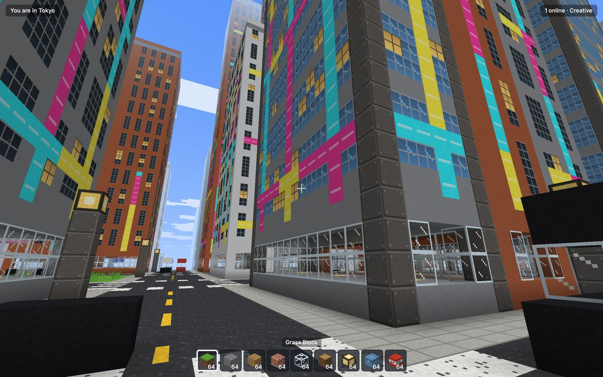
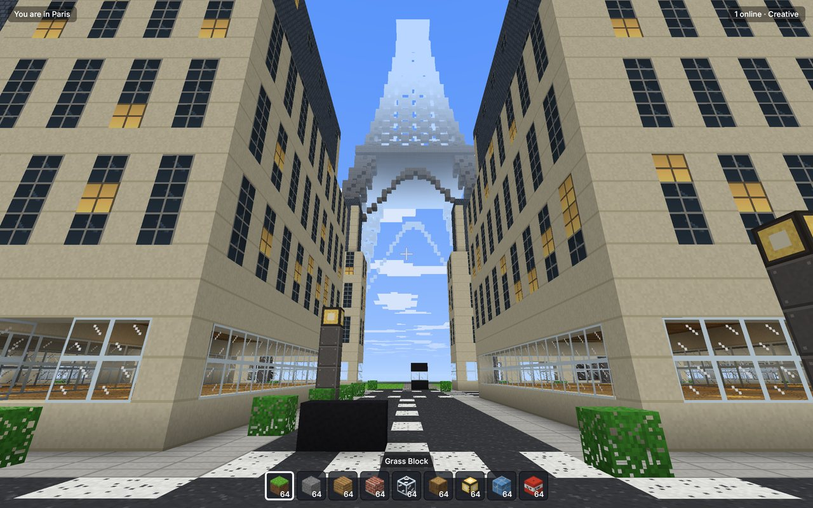
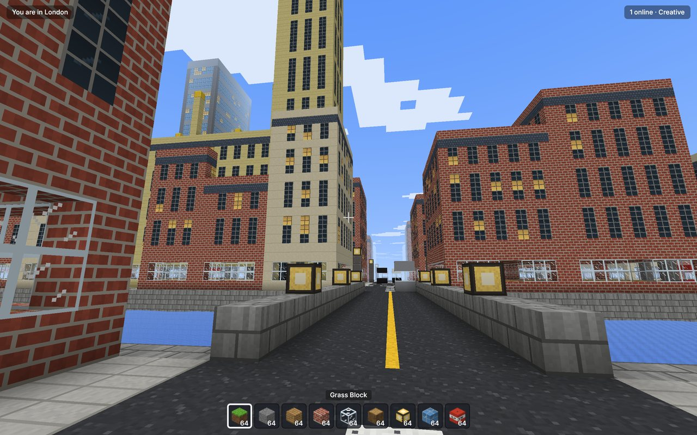
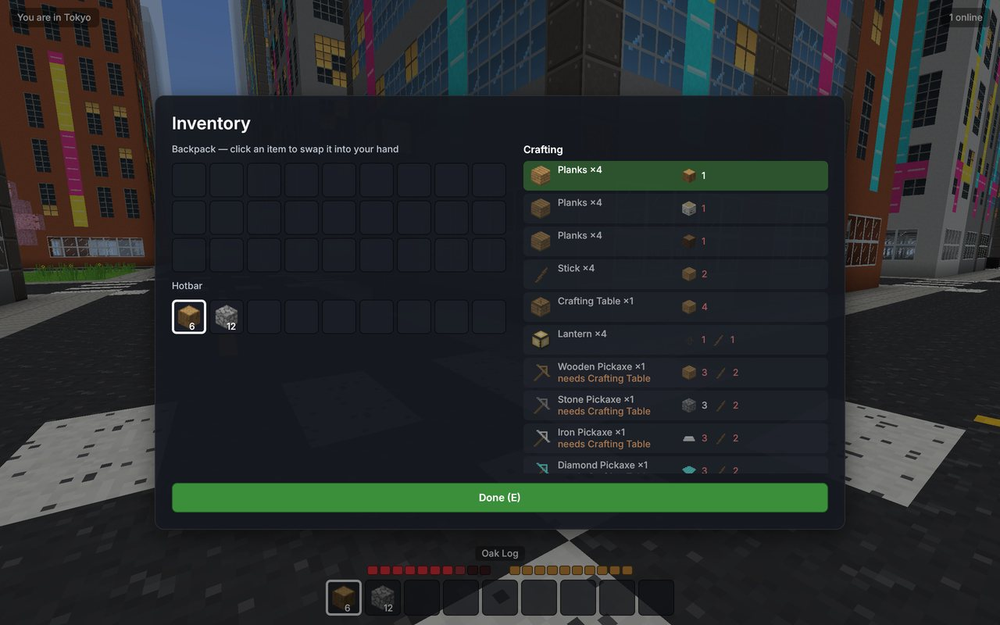
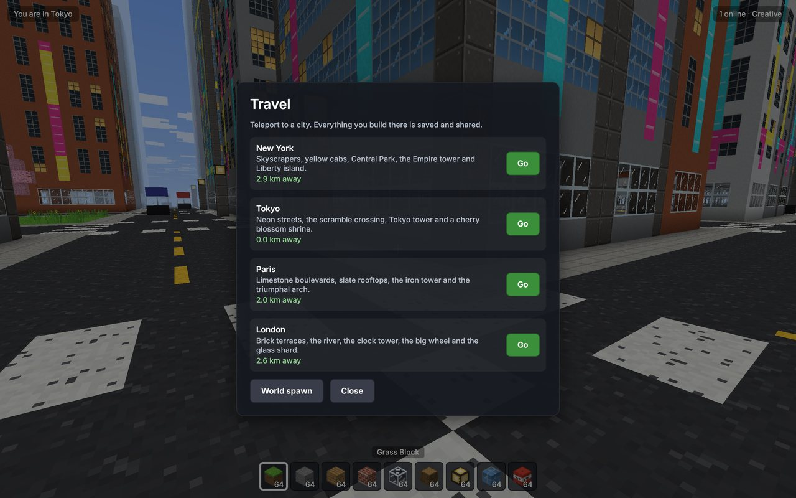

# RuneCraft

A multiplayer block-building sandbox written in Rust with the [Rune](https://github.com/anomalyco/rune) UI framework. Explore an endless generated world, mine and build, survive the night, and travel to block-built versions of **New York, Tokyo, Paris and London** with your friends.


| | |
|---|---|
|  |  |
|  |  |
|  |  |
|  |  |

## Play

You need Rust ([rustup](https://rustup.rs)); the right toolchain installs itself from `rust-toolchain.toml`. On Linux you also need the keyboard library headers: `sudo apt install libxkbcommon-dev` (Debian/Ubuntu).

```sh
cargo run --release
```

Use `--release`: the first build takes a few minutes, and debug builds are noticeably slower in game.

On the title screen:

- **Play** opens (or creates) a world on your computer. Worlds save automatically to `~/.runecraft/worlds/<name>`.
- **Host on LAN** does the same and lets people on your network join. Your LAN address shows in the top right corner in game.
- **Join Server** connects to a friend's LAN game or a dedicated server (`host` or `host:port`, default port 25575).

### Dedicated server

```sh
cargo run --release -p runecraft-server -- --port 25575 --world worlds/main --seed 1234
```

Options: `--port`, `--world <dir>`, `--seed <n>` (new worlds only), `--view <chunks>`, `--motd <text>`, `--no-mobs`. Press Enter in the terminal to save and stop. To play over the internet, forward TCP port 25575 on your router to the server machine.

## Controls

| Key | Action |
|---|---|
| W A S D | Walk |
| Drag the mouse (or arrow keys) | Look around |
| Click / hold | Mine a block, hit a mob |
| Right-click | Place a block, eat, open a crafting table, light TNT |
| Space | Jump; double-tap to fly in Creative |
| Shift / Ctrl | Sneak or fly down / sprint |
| 1–9, mouse wheel | Choose a hotbar slot |
| E | Inventory and crafting |
| M | Travel to a city |
| T, Enter or / | Chat and commands |
| F | Toggle flying (Creative) |
| F3 | Debug info |
| Esc | Pause menu (settings, game mode, quit) |

Commands: `/tp tokyo`, `/tp new york`, `/tp x y z`, `/tp <player>`, `/spawn`, `/time day|night|noon|midnight`, `/gamemode creative|survival`, `/fly`, `/list`, `/seed`, `/help`.

Mouse look works by dragging because Rune doesn't capture the pointer yet; a quick click (without dragging) mines.

## What's in the game

- **Endless world** built from a seed: plains, forests, birch forests, cherry groves, deserts with cacti, snowy tundra, mountains, oceans and beaches; caves with lava at the bottom; coal, iron, gold and diamond ores; trees, grass and flowers.
- **Cities**, the same in every world:
  - **New York**: a grid of skyscrapers with setbacks, spires and water towers; Times Square neon; yellow cabs; Central Park with its lake; the stepped Empire tower; a river around Manhattan with bridges; the Liberty statue on her island.
  - **Tokyo**: dense neon-covered streets, the scramble crossing, the red-and-white Tokyo tower with observation decks, and a shrine garden with cherry trees.
  - **Paris**: limestone boulevards with slate mansard roofs and hedges, the iron tower on its lawn, and the triumphal arch in a roundabout.
  - **London**: brick and limestone terraces, red cars, the Thames with bridges, the clock tower and parliament, the big observation wheel, and a glass shard skyscraper.
- **68 blocks and 15 items**, all with textures painted in code: building materials, glass, wool, concrete, neon, lanterns and glowstone (real light sources), TNT that explodes and chains.
- **Creative mode**: every block, flying, instant breaking.
- **Survival mode**: mining times by block hardness and tool, drops, health, hunger, drowning, fall and lava damage, death and respawn; **crafting** (planks, sticks, tables, pickaxes, swords, furnace smelting, glass, bricks, ingots, TNT, bread, lanterns).
- **Mobs**: pigs and sheep wander the countryside; zombies come out at night and chase you.
- **Day and night** with sunsets, stars, a moon, drifting clouds, smooth lighting and ambient occlusion, warm block light, fog and underwater effects.
- **Multiplayer**: players see each other with animated avatars and name tags, share every block edit, chat, and see the same time of day and mobs. The server saves all edits and where each player left off.

## How it's built

```
crates/common   Game rules shared by client and server: blocks, world generation, cities,
                physics, raycasting, crafting, and the network protocol.
crates/server   The authoritative server (also embedded in the client for single player and LAN).
crates/client   The game: a Rune app with a custom 3D renderer.
```

**Rune** draws all the 2D interface: title screen, HUD, hotbar, inventory, crafting, travel and pause menus, chat and name tags, and handles keyboard and pointer input. Rune is a 2D UI framework, so the 3D world is drawn by RuneCraft's own wgpu renderer, plugged in through Rune's `Compositor` hook (`crates/client/src/render.rs`): each frame it draws the sky, chunk meshes, water, players and mobs into the window, then asks Rune to draw the interface on top.

The world is stored in 16×16×256 columns. The server generates them on worker threads and streams them run-length encoded over TCP (length-prefixed bincode frames). The client meshes 16³ sections on worker threads with flood-filled sky and block light, smooth lighting and ambient occlusion.

## Tests

```sh
cargo test --workspace
```

Tests cover world generation, cities, physics, the protocol, the server (a client joins, gets chunks, edits, and the edit is saved), meshing, input routing through Rune's headless runtime, and a full two-player session (join, see each other, walk, break a block, chat).

The game can also render itself without a window: `cargo run -- --snap shot.png --scene newyork` (scenes: `play`, `newyork`, `tokyo`, `paris`, `london`, `night`, `friends`, `inventory`, `survival`, `travel`).

## License

MIT
